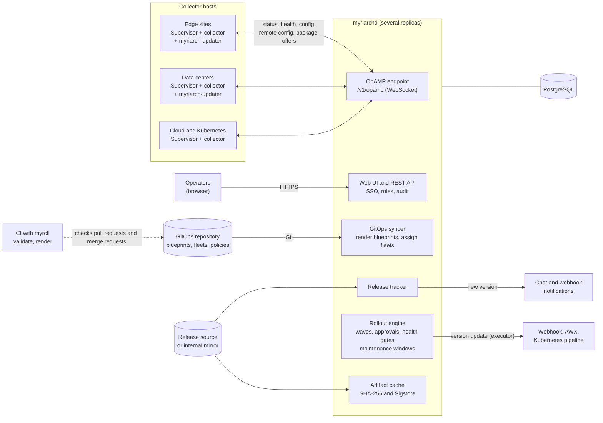

<p align="center">
  <picture>
    <source media="(prefers-color-scheme: dark)" srcset="assets/brand/myriarch-horizontal-dark.svg">
    
  </picture>
</p>

<p align="center"><strong>A GitOps-governed fleet manager for OpenTelemetry Collectors, built on OpAMP.</strong></p>

<p align="center">Website: <a href="https://myriarch.dev">myriarch.dev</a> (documentation and API reference). The documentation sources are in <a href="docs/">docs/</a>.</p>

Myriarch manages large fleets of OpenTelemetry Collector Contrib instances over
[OpAMP](https://github.com/open-telemetry/opamp-spec). It is designed for around 1,000 collectors, with headroom up
to 5,000, spread over edge sites, data centers, cloud and Kubernetes.

## The problem it solves

Collectors run under the upstream OpAMP Supervisor. The supervisor manages configuration, health and restarts, but it
cannot replace the collector binary (see [docs/design/upstream-notes.md](docs/design/upstream-notes.md)). Fleets
therefore end up with many versions and hand-made update procedures.

Myriarch closes that gap and keeps operators in control:

- **Git sets the frame, the UI operates within it.** Blueprints, fleets, rollout policies and the allowed collector
  versions live in a Git repository. The UI chooses within that frame (for example, a target version from the allowed
  range) and never edits the declared state.
- **Everything is audited.** Every operator action, API call and rollout step is recorded.
- **Changes roll out in waves.** Canary groups, percentage steps, approvals, health gates, failure thresholds,
  pause, abort, rollback and maintenance windows in the local time zone of each site.

## Features

- **Overview:** every collector with version, health, effective configuration, components and host attributes, live.
- **Version awareness:** new upstream releases are detected, breaking changes are extracted from the changelogs,
  outdated collectors are flagged, and notifications go to Teams, Slack or a webhook.
- **Controlled updates:** configuration and version rollouts in waves, with approvals, health gates, failure
  thresholds, pause, abort and rollback.
- **Blueprints:** layered, parameterized collector configurations ("edge hosts get X, data centers get Y") with
  site-specific parameters, rendered on the server into one content-addressed configuration per collector.
- **Exchangeable executors:** collector binaries are updated by the host agent `myriarch-updater`, or by a webhook or
  AWX call into your existing tooling or Kubernetes pipeline.
- **GitOps:** `myrctl validate` and `myrctl render` check pull requests and merge requests in CI.
- **Operations:** OIDC single sign-on, a bootstrap administrator for installations without an identity provider,
  roles (viewer, operator, admin), API tokens, an audit log, and high availability with several replicas on PostgreSQL.

## Status

Myriarch is **alpha**. v0.1.0 is the first final release. Release candidates (`vX.Y.Z-rc.N`) are published as GitHub
pre-releases; all releases are on the [releases page](https://github.com/myriarch/myriarch/releases). Interfaces,
configuration and the GitOps format (`myriarch.dev/v1alpha1`) can still change. Every release, release candidates
included, is signed keyless and carries build provenance; [verify it](docs/security/verify-releases.md) before you run it.

| Component | Support level |
|---|---|
| `myriarchd` and the web UI | Alpha |
| Container mode of `myriarch-updater` (Kubernetes pods) | Beta |
| Linux hosts (systemd) | Beta |
| Windows hosts | Experimental |
| Server Helm chart `deploy/helm/myriarch` | Beta |
| Collector Helm chart `deploy/helm/myriarch-collector` | Experimental |

What the levels mean:

- **Alpha:** works end to end, but interfaces, configuration and behavior can change without notice.
- **Beta:** covered by automated tests and the end-to-end and cluster probe runs; breaking changes are announced in the
  [changelog](CHANGELOG.md).
- **Experimental:** limited testing; it can change incompatibly or be removed.

The platforms that the automated tests run on are in [Support levels and tested platforms](docs/operations/tested-platforms.md).
If you run v0.1.0, read the [upgrade notes for v0.2.0](docs/operations/upgrade-to-v0-2-0.md) first. The scope of v0.1.0 is in
[ADR-0021](docs/adr/0021-publication-gates-and-v0-1-0-scope.md); plans are in [ROADMAP.md](ROADMAP.md).

## Quickstart

This runs the server with an embedded PostgreSQL, the example GitOps repository and 1,000 simulated collectors on your
machine. It needs no container runtime.

Prerequisites: Go (the version required by `go.mod`), Node.js (the version in `.node-version`; at least 22.22.2 or 24.15, see `engines` in `web/package.json`), pnpm 10, `make`, `curl`, `jq` and
`python3`. Git must be installed.

```bash
git clone https://github.com/myriarch/myriarch.git
cd myriarch

make web-build      # build the web UI into internal/webui/dist (once, and after UI changes)
ulimit -n 65536     # macOS only: the default of 256 open files is too low for thousands of WebSockets
make dev            # build and start myriarchd in dev mode (embedded PostgreSQL, examples/quickstart)
```

Open <http://localhost:8080> and sign in as `admin` / `admin` (full access), `operator` / `operator` or
`viewer` / `viewer`. The first start downloads the PostgreSQL binaries once (about 30 MB).

In a second terminal, start the simulator:

```bash
ulimit -n 65536     # macOS only, same reason as above
make sim            # 1,000 simulated collectors and 900 updaters connect to ws://localhost:8080/v1/opamp
```

After a few seconds the dashboard shows the agents of the three example fleets `linux-hosts`, `windows-hosts` and
`k8s-gateway`. Validate and render the example GitOps repository the way CI does:

```bash
make build
bin/myrctl validate --strict --components examples/sim/components-otelcol-contrib-0.162.0.json examples/quickstart
bin/myrctl render --dir examples/quickstart --fleet windows-hosts --sample windows-edge-01
```

`Ctrl+C` stops both terminals. Dev data lives in `.dev/`; `rm -rf .dev` resets everything.

> **Dev mode is not for production.** `myriarchd dev` creates well-known logins and a well-known enrollment token and
> refuses non-loopback addresses unless `--allow-nonlocal` is given (never do that outside a lab). For a production-like setup use `myriarchd serve` and read
> [docs/operations/production-checklist.md](docs/operations/production-checklist.md). More local walkthroughs:
> [docs/getting-started/local-dev.md](docs/getting-started/local-dev.md).

### Kubernetes on your machine

`make kind-probe` builds a local [kind](https://kind.sigs.k8s.io/) cluster from zero, installs the Helm chart and runs
numbered checks of the whole flow, including a collector version update. It needs Docker. See
[hack/kind/README.md](hack/kind/README.md). To install the Helm chart on your own cluster, follow
[Install with Helm](docs/operations/install-helm.md).

With Docker Compose, [docs/getting-started/docker-compose.md](docs/getting-started/docker-compose.md) starts the server,
PostgreSQL and 200 simulated collectors from the release images (published with every release candidate and release); the
Compose files in `deploy/compose/` are meant for evaluation and development only. For a guided first session from source, with a
fleet and a rollout policy of your own, read
[docs/getting-started/first-fleet-and-rollout.md](docs/getting-started/first-fleet-and-rollout.md).

### Connect a real collector

Create an enrollment token in the UI. The dialog *Add host* renders the install command for Linux or Windows, which you copy to
the host; the installer (`deploy/scripts/install-linux.sh --server …` or `deploy/scripts/install-windows.ps1 -Server …`) then
fetches everything else from the server. Alternatively, run the installer with your own inputs on the manual path. The
step-by-step guide is [docs/tasks/connect-a-host.md](docs/tasks/connect-a-host.md).

## Architecture



Every collector runs under the OpAMP Supervisor and keeps a WebSocket connection to `myriarchd`. The server renders the
blueprints of the GitOps repository per fleet, distributes configurations and versions through the rollout engine in
waves, and reports new upstream releases. State lives in PostgreSQL, so several `myriarchd` replicas can run in
parallel. Details: [docs/architecture.md](docs/architecture.md).

## Components

| Component | Purpose |
|---|---|
| `myriarchd` | Server: OpAMP endpoint, REST API, embedded web UI, GitOps syncer, rollout engine, release tracker, artifact cache, notifier |
| `myrctl` | CLI for the CI pipelines of the GitOps repository (`validate`, `render`); a short alias `myr` is documented in [docs/reference/cli/myrctl.md](docs/reference/cli/myrctl.md) |
| `myriarch-updater` | Host agent for collector binary updates (systemd, Windows service, container mode) |
| `myriarch-sim` | Load simulator (1,000 and more simulated supervisors and updaters) |
| Helm charts | [`deploy/helm/myriarch`](deploy/helm/myriarch/README.md) (the server) and `deploy/helm/myriarch-collector` (collectors on Kubernetes); from v0.2.0 both are also signed OCI charts |
| Container images | `ghcr.io/myriarch/myriarch` (the server, with `myrctl`, `myriarch-sim` and the example repositories) and `ghcr.io/myriarch/myriarch-updater`, for `linux/amd64` and `linux/arm64`; published with every release, release candidates included (tags `X.Y.Z` and `X.Y`, `X.Y.Z-rc.N` for a candidate, no `latest`). `myrctl` and the simulator are also in the release archives |

## Documentation

- [Documentation home](docs/_index.md): map of all sections
- [Getting started](docs/getting-started/_index.md): from source or with Docker Compose to a running system
- [Concepts](docs/concepts/_index.md): GitOps, agents, blueprints, fleets, inventory, rollouts, executors
- [Tasks](docs/tasks/_index.md): connect a host, roll out a change, simulate a fleet
- [Operations](docs/operations/_index.md): installation with Helm, authentication, production checklist, troubleshooting
- [Reference](docs/reference/_index.md): GitOps schema, command-line reference, [REST API](api/openapi.yaml)
- [Security model](docs/security/_index.md)
- [Architecture](docs/architecture.md), [design contracts](docs/design/README.md) and [decision records](docs/adr/README.md)
- [Development guide](docs/development.md)

## Community and contributing

Contributions are welcome: bug reports, documentation, tests and code. Start with [CONTRIBUTING.md](CONTRIBUTING.md).

- [CODE_OF_CONDUCT.md](CODE_OF_CONDUCT.md): how we treat each other
- [SECURITY.md](SECURITY.md): report vulnerabilities privately
- [GOVERNANCE.md](GOVERNANCE.md), [MAINTAINERS.md](MAINTAINERS.md) and [CONTRIBUTOR_LADDER.md](CONTRIBUTOR_LADDER.md)
- [ROADMAP.md](ROADMAP.md) and [CHANGELOG.md](CHANGELOG.md)
- [ADOPTERS.md](ADOPTERS.md): using myriarch? Add your organization.

Website: <https://myriarch.dev>.

## License

The source code is licensed under the Apache License 2.0; the license text is in [LICENSE](LICENSE). The Markdown
documentation (`docs/`, the decision records, the website text and the other Markdown files such as this README) and the brand
artwork are licensed under CC-BY-4.0 ([LICENSES/CC-BY-4.0.txt](LICENSES/CC-BY-4.0.txt)); code snippets inside the documentation
are Apache-2.0. Exceptions under Apache-2.0: [GOVERNANCE.md](GOVERNANCE.md) and [CONTRIBUTOR_LADDER.md](CONTRIBUTOR_LADDER.md)
(adapted from an Apache-2.0 template) and the GitOps template in `gitops-template/`. The rationale is in
[ADR-0018](docs/adr/0018-license-and-copyright.md) and [ADR-0030](docs/adr/0030-reuse-compliance-and-third-party-notices.md).

The repository is compliant with the [REUSE specification](https://reuse.software/spec-3.3/) 3.3: source files carry an SPDX
header, and [REUSE.toml](REUSE.toml) assigns a license and a copyright holder to every other file, including third-party
content with its attribution. `make licenses-check` verifies this ([ADR-0030](docs/adr/0030-reuse-compliance-and-third-party-notices.md)).

The notices and license texts of the third-party software in the binaries are in [THIRD_PARTY_NOTICES](THIRD_PARTY_NOTICES).
The file is part of every release archive and every container image, and a running `myriarchd` serves it, together with
`LICENSE`, without login at `/licenses`. The project has no NOTICE file of its own.

## Trademarks

OpenTelemetry, Kubernetes and CNCF are trademarks of The Linux Foundation. Myriarch is an independent project; it is not
affiliated with or endorsed by The Linux Foundation or the OpenTelemetry project. Third-party names are used only to
describe compatibility ([ADR-0016](docs/adr/0016-trademark-usage-and-name-protection.md)).
