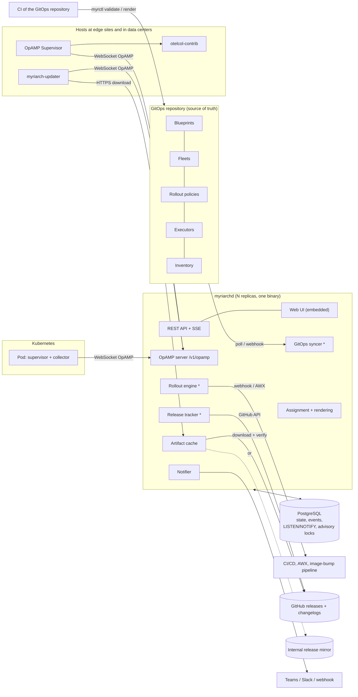
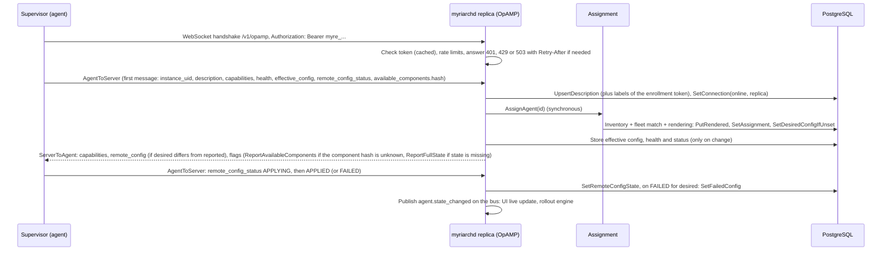
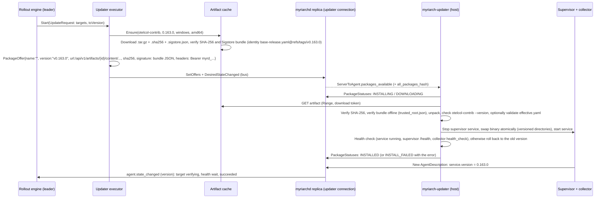
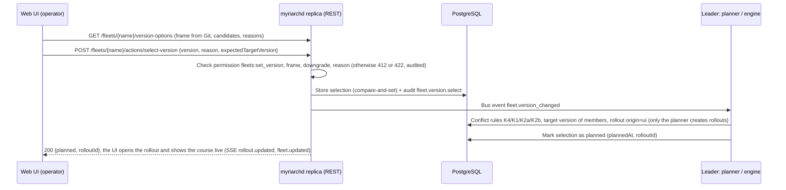

Myriarch manages fleets of OpenTelemetry Collector instances over OpAMP: collectors on hosts at edge sites and in data centers, and collectors in Kubernetes. The design target is 1,000 to 5,000 collectors, each with an optional `myriarch-updater` next to it. This document describes the components, the data flows, high availability, scaling, data retention and operations. The reasons behind the main choices are in the [decision records](adr/README.md). The facts about third-party software that the design relies on are in [upstream notes](design/upstream-notes.md). The configuration format is documented in [GitOps concepts](concepts/gitops.md) and the [GitOps schema reference](reference/gitops-schema.md), and the REST API in [`api/openapi.yaml`](../api/openapi.yaml).

## Overview

`*` marks work that runs only on the leader replica.

### Components

| Component | Packages | Purpose |
|---|---|---|
| **myriarchd** | `cmd/myriarchd` | One binary: HTTP server (UI, REST, SSE and OpAMP on one port), background jobs, the commands `serve`, `dev`, `migrate`, `config` and `auth` |
| OpAMP server | `internal/opamp` | Connections (opamp-go), evaluation of all `AgentToServer` fields, push of remote configuration, packages, restart and flags, offline detection |
| Persistence | `internal/store`, `internal/store/postgres`, `internal/store/migrations` | PostgreSQL (pgx), embedded schema migrations (goose) |
| Event bus | `internal/eventbus`, `internal/eventbus/pgbus` | Cluster-wide events over `LISTEN`/`NOTIFY` |
| Leader election | `internal/leader`, `internal/leader/pglock` | Advisory lock for singleton jobs |
| Authentication and authorization | `internal/authn`, `internal/authz` | OIDC, bootstrap admin, development login, sessions, API tokens, enrollment tokens, mutual TLS, roles |
| Audit | `internal/audit` | Audit log of all state-changing actions |
| REST | `internal/coreapi`, `internal/fleetapi`, `internal/live`, `internal/httpserver`, `internal/api` | Agents, statistics, system, audit, users and tokens; fleets, rollouts, releases, GitOps and notifications; SSE; the server chain and the shared API plumbing |
| GitOps syncer | `internal/gitops` | Clone or fetch (go-git), parse, validate, atomic apply |
| Blueprint rendering | `internal/blueprint` | Parameters, `[[ ]]` templating, merge, validation, canonical form |
| Assignment | `internal/assignment` | Inventory, fleet selectors and priorities, bootstrap rule |
| Rollout engine | `internal/rollout` | Planner, waves, gates, maintenance windows, operator actions |
| Executors | `internal/executor/updaterexec`, `.../webhookexec`, `.../manualexec` | `updater` (OpAMP packages), `webhook` and `awx`, `manual` (no external call) |
| Release tracker | `internal/release` | GitHub releases and breaking changes from changelogs |
| Artifact cache | `internal/artifact` | Download, SHA-256 and Sigstore verification, delivery with download tokens |
| Notifier | `internal/notify`, `internal/notify/channels` | Microsoft Teams, Slack and generic webhook |
| Housekeeping | `internal/housekeeping` | Retention jobs on the leader |
| Outbound connection policy | `internal/netguard` | Destination checks, proxy and CA handling for every outbound connection |
| **myrctl** | `cmd/myrctl`, `internal/myrctl` | `validate` and `render` for the CI of the GitOps repository |
| **myriarch-updater** | `cmd/myriarch-updater`, `internal/updater` | Host agent for collector binary updates (systemd, Windows service, container mode in a pod) |
| **myriarch-sim** | `cmd/myriarch-sim`, `internal/sim` | Load simulator (1,000 or more supervisors and updaters in one process) |
| Web UI | `web/`, `internal/webui` | React and TypeScript (Vite), embedded with `go:embed` (build tag `embedui`) |
| Deployment | `deploy/` | Helm chart, Compose file, supervisor configurations, installation scripts, systemd units, Dockerfiles |

### Code organization and contracts

The interface packages are the basis that other packages depend on: `internal/domain` (the shared model), `internal/store` (interfaces), `internal/eventbus` (interface and in-memory bus), `internal/leader` (interface and `AlwaysLeader`), `internal/control`, `internal/executor` (interface), `internal/notify` (interface), `internal/authz`, `internal/api` with `internal/api/dto`, `internal/audit`, `internal/config`, `internal/brand` (fixed identifiers), `internal/version`, `internal/webui`, `api/openapi.yaml` and `internal/store/migrations/00001_initial.sql`.

REST routes: each domain package supplies `api.Module` values with `api.Route{Method, Pattern, OperationID, Permission, Auth, Handler}`. `internal/httpserver` mounts all modules under `/api/v1` on a standard `ServeMux` and enforces authentication, CSRF protection and permission centrally. Nobody edits a shared router file ([ADR-0010](adr/0010-standard-servemux-and-hand-written-dtos.md)). The test `internal/api/dto/contract_test.go` checks that Go types and OpenAPI schemas match field by field.

## Data model

See `internal/domain` and the migrations in `internal/store/migrations`.

- **agents**: one row per OpAMP instance UID (a collector or a `myriarch-updater`), with the reported state (description, connection, health tree, remote configuration status, effective configuration hash, component hash, package status) and the desired state (fleet, assigned, desired and failed configuration hash, target version). The generated column `config_sync` yields `none`, `in_sync`, `pending`, `failed` or `drift`.
- **rendered_configs**, **effective_configs**, **component_sets**: content-addressed by SHA-256.
- **gitops_objects** (the active snapshot), **gitops_syncs** (history), **gitops_status**.
- **rollouts**, **rollout_waves**, **rollout_targets** (targets carry the live progress), **package_offers** (the desired packages per updater), **fleet_version_selections** (the target version chosen in the UI, one row per fleet).
- **releases**, **artifacts**, **users**, **sessions**, **api_tokens**, **enrollment_tokens**, **saved_filters**, **audit_events**, **agent_events**, **replicas**, **kv**.

### Desired state of an agent

| Field | Written by | Meaning |
|---|---|---|
| `fleet_name`, `assigned_config_hash`, `target_version` | Assignment, and the leader after a change of the UI selection | What Git declares for this agent. `target_version` is the **effective target** of the fleet: the Git target or the UI selection |
| `desired_config_hash` | Assignment (bootstrap), rollout engine | What `myriarchd` currently offers to the agent |
| `failed_config_hash` | OpAMP server | The hash the agent reported as `FAILED`; it is not offered again automatically |
| `package_offers` (updaters) | Updater executor | The complete set of offered packages |

The **target version** has two sources: the Git target `spec.collector.version`, and, if Git allows it within `spec.update.selection`, the choice of an operator in the UI (`fleet_version_selections`: version, who, when, why, and the Git state at the time of the choice). A single resolver (`domain.ResolveVersionTarget`) turns both into the effective target (`git`, `ui`, `hold` or `none`). The planner, assignment, statistics, release pages, dashboard and artifact prefetch use only this resolver ([ADR-0013](adr/0013-target-version-from-the-ui-within-the-git-frame.md), [Version selection](design/version-selection.md)).

On every agent message and on every `agent.desired_changed` event the OpAMP server reconciles: it sends `remote_config` when `desired` differs from the reported hash and from `failed`, and it sends `packages_available` when the `server_provided_all_packages_hash` reported by the updater differs from the current `AllPackagesHash(offers)`.

## Data flows

### Agent connection and registration

Further rules:

- **Identity.** The `instance_uid` (16 bytes) is the primary key. If the same UID connects on a new connection with the same credential, the new connection replaces the old one. If a message with a UID that is online arrives from a different host, the server treats it as a clone, assigns a new UID to the newcomer and raises the event `identity_conflict`. A connection with a different credential for a known UID is rejected ([Security model](security/model.md#agent-authentication)).
- **Classification.** `service.name == "myriarch-updater"` makes the agent an `updater`. Otherwise the capability `AcceptsRemoteConfig` makes it a `collector`, and everything else is `unknown`.
- **Updater link.** The attribute `dev.myriarch.collector.instance_uid` of an updater links it to its collector (`SetUpdaterLink`).
- **Heartbeats.** The supervisor sends a heartbeat every 30 seconds by default. `last_seen_at` is written in batches every 15 seconds (`opamp.lastSeenFlushInterval`).
- **Reconnect.** After a reconnect the client does not send a full description. The server sets `ReportFullState` when a new connection lacks `agent_description` or when `sequence_num` jumps.
- **Offline.** A closed connection means offline at once. For half-open connections the leader's sweeper marks an agent offline after `opamp.offlineAfter` (90 seconds) without a message. If a replica dies, the leader marks all agents of that replica offline (replica heartbeat older than 30 seconds).

### Config rollout

1. A commit is merged in the GitOps repository. CI runs `myrctl validate` before the merge.
2. The syncer (on the leader) fetches the commit by poll (60 seconds) or webhook, parses and validates **everything**. If the revision is invalid, the old state stays active, the status becomes `error` and the notification `gitops.sync_failed` is sent.
3. A valid revision is applied atomically (`ApplySnapshot`), then `ReassignAll` assigns and renders every agent again. `assigned_config_hash` changes for affected agents. New agents get their configuration at once (bootstrap).
4. The planner creates one rollout of kind `config` per fleet (`toRef` is the commit, targets carry from and to hash, waves follow a snapshot of the policy). An older active config rollout of the fleet becomes `superseded`.
5. The engine ticks on the leader (every 5 seconds and on events). It starts the targets of the current wave if they are online, inside their maintenance window and below `maxConcurrent`: `SetDesiredConfig(ids, hash)` and `control.DesiredStateChanged(ids)` publish on the bus, and the replica that holds the connection pushes `remote_config`.
6. When the agent reports `APPLIED`, the target is `verifying`, and after the health wait without unhealthy or offline reports it is `succeeded`. `FAILED`, a timeout or an unhealthy agent makes it `failed`. A reached failure threshold pauses the rollout or rolls it back.
7. A finished wave starts the next one, which may need an approval (`waiting_approval`). When the last wave is finished, the rollout is `completed` and a notification is sent.

### Version rollout through myriarch-updater

Completion is **always** recognized by the collector version the agent reports. `INSTALL_FAILED` ends the target at once as `failed`. The contract between server and updater is in [Updater protocol](design/updater-protocol.md).

**Live progress.** The updater reports the course of its attempt as state in the health component `dev.myriarch.update` (children `version`, `from` and `step`, one of `downloading`, `verifying`, `installing`, `restarting`, `health_check` and `rolling_back`, each with status and times). The server stores the health tree anyway, so no OpAMP protocol extension is needed. On every tick the engine derives `RolloutTarget.progress` from it per target (phase, steps, download percentage, error; source `updater`, or just the package status as a fallback, and for other executors only "offered", "waiting for version" or "health wait"), stores it and freezes it with the final status. The UI shows the course live through SSE (`rollout.updated`). Details and assignment rules are in [Version selection](design/version-selection.md#target-progress) and [Rollouts](concepts/rollouts.md).

**Second mode: container mode.** The same `myriarch-updater` also runs **inside the pod** of a Kubernetes gateway (`myriarch-updater container`). It is PID 1 there and starts the supervisor as a child process. "Restart" means restarting the child, and the collector binary lies in versioned directories with a `current` symlink on a volume. Download, SHA-256 and Sigstore verification, swap, health check and automatic rollback are the same code as on hosts ([ADR-0014](adr/0014-binary-updates-in-the-pod-via-container-mode.md), [Container mode](design/container-mode.md)). Where agents in a cluster cannot reach the public route, the updater downloads from a service in the namespace (`artifacts.agentBaseUrls`), and `myriarchd` fetches artifacts from an internal mirror. On Kubernetes the preferred path for version changes is the image, as described in [ADR-0026](adr/0026-collector-version-updates-on-kubernetes.md).

**Health check and crash loop.** The normal start (`StatusStarting`, then `StatusOK`) does not count as a failure. The engine remembers per target, in the annotations of the rollout (so it survives a leader change), whether the collector was healthy after the new version appeared. If it falls back to "starting" more than once after that (the process dies and is restarted), the target fails with "crash loop".

### Version rollout through webhook or AWX

1. The engine starts the targets of a wave in batches (`batchSize`). The executor calls the webhook or launches the AWX job template (HMAC-signed or with a bearer token). A `2xx` answer makes the targets `in_progress` (`executorRef` is the job or delivery ID). An error makes the targets `failed`; `retry-failed` repeats them.
2. The external system updates the collector (package management, image tag bump in Kubernetes).
3. The collector reconnects and reports the new `service.version`: the target is `verifying`, then `succeeded`.
4. `applyTimeout` without a new version makes the target `failed`.

**Slow receivers.** Executor calls do not run inside the critical section of the engine. A tick waits for one call for at most 2 seconds (and 10 seconds in total per tick). After that the call continues in the background, bounded by `rollouts.executorTimeout` (default 2 minutes). Its targets stay `pending`, the rollout starts nothing new until the result is known, and the planner, other rollouts and operator actions carry on. The result is taken over in the next tick. After a leader change the (idempotent) call is simply repeated. An `abort` during a running call takes back the updates that already started.

**Executor `manual`.** It makes no external call. It reports the targets as started at once, the rollout waits for the reported version like with every executor and ends at `applyTimeout`. It fits setups where the version changes outside `myriarchd` (an image tag by merge request, an operator on the host) and `myriarchd` only tracks course and result.

### GitOps sync

- **Sources.** An `https://` or `ssh://` repository (go-git, token or SSH key file, own CA) or a `dir:` directory (development and tests; the revision is a content hash).
- **Triggers.** Start, poll interval, webhook (`POST /api/v1/gitops/webhook`, GitLab `X-Gitlab-Token` or GitHub `X-Hub-Signature-256`) and manually (`POST /api/v1/gitops/actions/sync`). Triggers on non-leaders are forwarded to the leader over the bus.
- **Sequence.** Fetch, parse all objects, validate (including rendering all fleets with sample agents), on success `ApplySnapshot` (atomic), `ReassignAll`, planner, bus event `gitops.synced`, UI.
- **Invalid revisions are never applied.** The UI shows `latestCommit` (invalid) next to `appliedCommit`.

### Release notification

1. The tracker (on the leader, hourly by default) requests `GET /repos/open-telemetry/opentelemetry-collector-releases/releases?per_page=30` with a token and `If-None-Match`. Tags matching `^v0\.\d+\.\d+$` (distributions) and `^cmd/opampsupervisor/v0\.\d+\.\d+$` are recognized, nightlies are ignored. GitHub Enterprise works through configurable base URLs.
2. For new versions the tracker loads `CHANGELOG.md` of core and contrib (at the target tag), extracts the sections whose heading contains "Breaking changes" or "Deprecations" for that version, and stores them.
3. The bus event `release.detected` shows a banner in the UI, and the notifier sends `release.new` or `release.breaking`.
4. For each release the UI shows the breaking changes (filterable by the components in use), the fleets whose target version is lower, and a GitOps snippet to raise it. Operators acknowledge the notice. The version change then happens either by merge request in the GitOps repository (Git target) or, for fleets whose Git frame allows it (`spec.update.selection`), with **Update to version X** on the release page: `ReleaseDetail.updatableFleets` says per fleet whether and why a version can be chosen. The choice follows the next section.

### Target version from the UI

- **Git sets the frame, the UI chooses inside it.** `spec.update.selection` (format in the [GitOps schema reference](reference/gitops-schema.md) and [Fleets](concepts/fleets.md)) states whether UI updates are allowed, which versions are selectable (range or list), whether a downgrade is allowed, whether a reason is needed and which rollout policy applies. Only the server knows the frame logic; the UI gets all dialog data from `GET /fleets/{name}/version-options`.
- **One writer for rollouts.** The REST replica stores only the selection; the planner on the leader creates the rollout, so there is no second writer even with several replicas. The call waits up to 10 seconds for the leader and then returns the `rolloutId`.
- **Conflict rules.** If Git changes something after a choice, the most recent explicit intent wins: a new Git target or withdrawn UI control means the Git target applies (selection deleted); a chosen version outside the new frame means **hold** (no target, a running rollout is superseded, no automatic downgrade); a deleted fleet drops its selection. All of this runs on the leader before reassignment and at the start of each planner run, is idempotent and audited (actor `gitops`). The rules are tabulated in [Version selection](design/version-selection.md#conflict-rules).
- **Visible and traceable.** A UI target is marked "set in the UI" (`versionTarget.source = ui`, who, when, why). The rollout carries `origin: ui`, the operator's name and the reason. The history is the audit log.
- **Replicas.** The selection lives in the database. Each replica keeps a cache for assignment and reloads it on `fleet.version_changed`; the UI receives `fleet.updated` through SSE.

### Rollout engine

The rollout engine (`internal/rollout`) runs on the leader and consists of the planner, the wave state machine and the executor dispatch.

- **Planner.** Creates rollouts from differences between the desired and the assigned state: a `config` rollout when the desired configuration hash of agents differs from the assigned one, and a `version` rollout when the effective target version of a fleet differs from what its collectors run (not when the executor is `none` or the fleet is in hold). It runs after each applied GitOps state and every minute, and its runs are serialized. There is at most one active rollout per fleet and kind. Only the planner creates rollouts.
- **Waves and gates.** A rollout has waves defined by the policy snapshot. A wave can need an approval, a target starts only when its agent is online, inside its maintenance window and below `maxConcurrent`. After a start, a target is `in_progress`, then `verifying` while the health wait runs, then `succeeded`. Targets that cannot be reached within the grace period are `skipped`.
- **Failure handling.** A failure threshold in the policy either pauses the rollout (`pause`) or rolls it back (`rollback`). Operators can pause, resume, abort, approve, roll back and retry failed targets; all actions are conditional updates with an audit entry.
- **Statuses.** A rollout is `pending`, `running`, `waiting_approval`, `paused`, `completed`, `failed`, `aborted`, `rolling_back`, `rolled_back` or `superseded`. Status changes use compare-and-set, targets use optimistic concurrency.
- **Crash safety.** All state lives in the database. The engine keeps nothing between ticks except caches, so a new leader continues where the old one stopped, and every step is idempotent or reconciled on the next tick.
- **Ticks and time budgets.** A tick runs every `rollouts.tickInterval` (default 5 seconds) and earlier after agent or rollout events, throttled to once per second. One planning or tick cycle is bounded to 60 seconds. Executor calls are described above under slow receivers.

The semantics of policies, waves, windows and thresholds are in [Rollouts](concepts/rollouts.md), and the engine's contract is in [Server behaviour](design/opamp-server.md#rollout-planner-and-engine).

## High availability

- **N equal replicas** behind a load balancer or ingress with WebSocket support, without session affinity. Every replica serves UI, REST and OpAMP.
- **State only in PostgreSQL.** Replicas keep connections and caches only.
- **Fan-out** of pushes to agents goes over the event bus (`LISTEN`/`NOTIFY`, channel `myriarch_events`). The replica that holds the connection performs the push. Losses are tolerable because every agent message is reconciled anyway and the engine ticks periodically.
- **Leader.** `pg_try_advisory_lock` with the key `ha.leaderLockKey` (default 7012024) on a dedicated session. Leader jobs: GitOps syncer, planner and rollout engine, release tracker, artifact prefetch, the sweeper for offline agents and dead replicas, and housekeeping. If the leader loses its database session, leadership ends at once and another replica takes over within a few seconds. Jobs are supervised and restarted individually with a backoff.
- **Operator actions** (pause, approve, ...) go to any replica: conditional updates (`CompareAndSetStatus`) plus a bus event to the leader.
- **Replica registry.** A heartbeat every 10 seconds (`ha.heartbeatInterval`, at most 10 seconds) into `replicas`; the leader removes replicas that are silent for more than 30 seconds.
- **PostgreSQL** is external (for example a replicated or managed service), with a direct connection or a pooler in **session** mode. Transaction pooling breaks `LISTEN` and advisory locks ([ADR-0002](adr/0002-postgresql-for-state-event-bus-and-leader-election.md)).
- **Rolling updates of myriarchd.** The Helm chart sleeps 10 seconds in `preStop` (`preStopSleepSeconds`), then OpAMP connections close gradually (at most 100 per second); agents reconnect with a backoff. Migrations run at start under an advisory lock and are backward compatible (expand/contract), with **one** documented exception: migration `00003_security_bindings` replaces the uniqueness of the OIDC subject by `(provider, issuer, subject)`. Replicas of the older version can then no longer store OIDC users (`ON CONFLICT (subject)`). For this upgrade, reduce to one replica and scale up afterwards, or accept failing OIDC sign-ins until the rolling update is complete. Existing sessions, agents, the API and tokens are not affected. The note is also in `NOTES.txt` of the Helm chart.

## Security

The security model has its own page: [Security model](security/model.md). In short:

- Agents authenticate with revocable **enrollment tokens**, optionally with mutual TLS, and the instance UID is bound to the credential of its first registration ([ADR-0012](adr/0012-agent-access-via-enrollment-tokens.md)).
- People sign in with OIDC (deny by default) or with the bootstrap admin ([ADR-0025](adr/0025-login-without-enterprise-idp.md)). Sessions, CSRF protection, API tokens, three roles (viewer, operator, admin) and an audit log of every state-changing action protect the REST interface.
- Software delivery is verified three times: SHA-256 and Sigstore bundle in the artifact cache, signed download tokens bound to updater and artifact, and SHA-256 plus Sigstore bundle again on the host, together with a host-side minimum version and anti-downgrade policy.
- Every outbound connection of the server passes `internal/netguard` (destination check on the resolved address, proxy, internal CA). Secrets come from files or the environment and never from Git.
- GitOps input is bounded: file counts and sizes, template run time and output, and no access to the environment, files or the network from templates.
- The Helm chart ships a NetworkPolicy. Vulnerabilities are reported according to [SECURITY.md](../SECURITY.md).

## Scaling

The numbers are design targets, not measured limits.

| Size | Assumption | Design |
|---|---|---|
| Agents | 1,000 collectors plus 1,000 updaters, headroom for 5,000 plus 5,000 | 2 to 3 replicas, up to 10,000 connections each (`opamp.maxConnectionsPerReplica`) |
| Messages | Heartbeat every 30 seconds gives about 330 per second at 10,000 connections | `last_seen` held in memory, batch flush every 15 seconds |
| Reconnect storm | All agents after a failover | 200 new authenticated connections per second per replica (`opamp.connectRateLimit`), otherwise `429` with `Retry-After` |
| Config push | One wave with 500 agents | Bus events in chunks of 100 IDs; the body is rendered once |
| Binary updates | About 112 MB per Linux host (contrib) | `maxConcurrent`, maintenance windows, range and resume, cache per replica |
| Database | Under 1 GB without events | A small HA instance; `max_connections` of the database at least replicas times `database.maxConns` (default 20) plus headroom |
| UI | Agent list of 5,000 or more rows | Server-side filter, sort and pagination, facets, SSE with coalescing |

Load test: `myriarch-sim` with 1,000 (or 5,000) supervisors plus updaters in one process ([Simulate a fleet](tasks/simulate-a-fleet.md)).

## Data retention

Housekeeping runs hourly on the leader. A retention of 0 disables the matching job.

| Data | Retention (default) | Setting |
|---|---|---|
| Agent events | 30 days | `retention.agentEvents` |
| Offline agents | Deleted after 30 days offline (0 = never) | `retention.offlineAgents` |
| Audit events | 400 days | `retention.audit` |
| Finished rollouts (with targets) | 180 days | `retention.finishedRollouts` |
| Unreferenced rendered and effective configurations | 7 days | `retention.unreferencedConfig` |
| GitOps sync history | 30 days | `retention.gitopsSyncHistory` |
| Expired sessions, single-use login and webhook delivery markers | Cleaned up continuously (markers after 1 hour) | Not configurable |
| Releases | Unlimited | |
| Artifacts (files per replica) | Least recently used, up to `artifacts.maxCacheBytes` (20 GiB) | `artifacts.maxCacheBytes` |

## Observability of myriarchd

- **Logs.** `log/slog`, JSON in production and text in dev mode (`telemetry.logFormat`, `telemetry.logLevel`). Fields include `replica`, `request_id`, `agent_id` and `rollout_id`. Log messages are in English.
- **Metrics.** Served at `/metrics` on a separate listener (`server.metricsListenAddr`, default `:9090`; empty serves them on the main port; `telemetry.metrics` switches them off). The metrics are unauthenticated, so restrict the port by network policy.
- **Health.** `/healthz` (the process is alive) and `/readyz` (the database answers, migrations are finished and the bus listener is connected; the answer says only "ready" or "not ready", the cause is in the log). The metrics listener also serves `/healthz`. `/licenses` serves the project license and the third-party notices as plain text, without login.
- **Later.** OTLP traces of `myriarchd` through its own collector are possible future work.

| Metric | Labels | Producer |
|---|---|---|
| `myriarch_opamp_connections` | `transport` | opamp |
| `myriarch_opamp_messages_total` | `direction` | opamp |
| `myriarch_opamp_connect_rejected_total` | `reason` | opamp |
| `myriarch_opamp_push_errors_total` | | opamp |
| `myriarch_opamp_message_duration_seconds` | | opamp |
| `myriarch_opamp_dropped_total` | `queue` | opamp |
| `myriarch_agents` | `status`, `kind` | opamp (leader) |
| `myriarch_config_sync` | `state` | opamp (leader) |
| `myriarch_eventbus_dropped_total` | `subscriber` | pgbus |
| `myriarch_leader` | | pglock |
| `myriarch_http_requests_total` | `route`, `method`, `code` | httpserver |
| `myriarch_http_request_duration_seconds` | `route`, `method` | httpserver |
| `myriarch_auth_logins_total` | `method`, `result` | authn |
| `myriarch_auth_agent_requests_total` | `result` | authn |
| `myriarch_auth_token_failures_total` | `reason` | authn |
| `myriarch_assignment_duration_seconds` | `result` | assignment |
| `myriarch_rollouts_active` | `kind` | rollout |
| `myriarch_rollout_targets` | `status` | rollout |
| `myriarch_rollout_transitions_total` | `to` | rollout |
| `myriarch_gitops_sync_total` | `result` | gitops |
| `myriarch_gitops_last_success_timestamp_seconds` | | gitops |
| `myriarch_release_polls_total` | `result` | release |
| `myriarch_release_latest_info` | `distribution`, `version` | release |
| `myriarch_artifact_downloads_total` | `result` | artifact |
| `myriarch_notifications_total` | `channel`, `result` | notify |
| `myriarch_housekeeping_deleted_total` | `job` | housekeeping |
| `myriarch_housekeeping_failures_total` | `job` | housekeeping |
| `myriarch_housekeeping_last_run_timestamp_seconds` | | housekeeping |
| `myriarch_job_cycle_duration_seconds` | `job` | shared by the leader jobs |

The gauges `myriarch_agents` and `myriarch_config_sync` are computed by the leader only; aggregate them in Prometheus with `max()`. The simulator exposes its own metrics under the prefix `myriarch_sim_`.

## Implementation notes

These points were fixed while integrating the components. They matter to anyone who changes the affected code.

- **Executor contract.** `TargetResult.RetryLater` (the artifact is still being prepared: the target stays `pending`, no error) and `CancelRequest.Refs` (external job IDs per agent, for example AWX) replace earlier conventions over `ExternalRef` and `Spec.Params`.
- **Push timeout** to slow agents: a goroutine plus `Connection.Disconnect()`. A write deadline on the `net.Conn` has no effect with gorilla/websocket ([upstream notes](design/upstream-notes.md#opamp-library-behaviour)).
- **Health after a restart.** An unhealthy state reported before the verification began belongs to the old process and does not fail the target ([Rollouts](concepts/rollouts.md)).
- **Start-up health.** After an update the real supervisor reports the new version first with `healthy=false`, then `StatusStarting`, then `StatusOK`. The engine does not treat these start-up reports as failures (at most until `applyTimeout`).
- **GitOps reconciliation.** `OnApplied` (reassignment of all agents and the planner) returns an error. The last fully reconciled revision is stored in `kv` (`gitops/reconciled-revision`). If the applied revision is not reconciled (an error, or a leader crash in the middle), the next sync cycle repeats the reconciliation, also on a new leader. `gitops.synced` is published directly after `ApplySnapshot` so that non-leaders reload their snapshot before the reassignment.
- **Retries after errors.** A configuration for which the agent reported `FAILED` is offered again only after the failure mark is cleared (`retry-failed`, resync). `FAILED` never counts as "reported by the agent", even if the hash equals the desired one (the supervisor's `validate_config` does not produce `APPLIED` for the old hash afterwards). A repeated identical failure sets the mark again. A package offer that is issued again with the same content after `INSTALL_FAILED` (`retry-failed`) is sent to the updater exactly once per connection.
- **Component set.** If the `available_components` set of a collector changes (for example after an update), the collector is assigned again, because the description (and with it the first assignment) is processed before the components.
- **Facets** of the agent list are disjunctive: the count of a facet ignores its own filter (multi-select), all other filters apply, and `total` counts with all filters.
- **Leader display.** `GET /system/info` shows at most one replica as leader (the latest heartbeat with the leader flag; a crashed leader keeps its flag in the heartbeat row until the reaper removes it).
- **Retry brake of the updater.** After a failed installation, the same `content_hash` is not tried again for 10 minutes (`update.failedRetryBackoff`; message `INSTALL_FAILED ... not retrying`), so `retry-failed` of a rollout action takes effect after that. Package offers need `PackageOffer.signature` as the raw Sigstore bundle JSON, and the download URL must lie under `update.allowedUrlPrefixes` (default: the `/api/v1/artifacts/` path on the host of the OpAMP endpoint, so `server.publicUrl` must have the same host).

## Artifact cache and mirror layout

Collector and supervisor binaries come from the upstream release downloads or from an internal mirror that copies them one to one in the layout `<sourceBaseUrl>/<tag>/<asset>`. The tag of a collector release is `v<version>`; the tag of a supervisor release is `cmd/opampsupervisor/v<version>`, with raw slashes in the URL. Beside each asset the mirror keeps `<asset>.sha256` and `<asset>.sigstore.json`. Artifactory (remote repository) and Nexus (raw proxy) can mirror the download URL without a URL template. Credentials for the mirror go in `artifacts.sourceAuth` and are sent only to the origin of the mirror. Verification (SHA-256 and Sigstore bundle with identity binding) happens in `myriarchd`, not in the mirror, so the mirror needs no trust.

On disk, the cache holds files by content under `<artifacts.dir>/sha256/<hex>`, plus a working area for downloads and the cached TUF metadata. Each replica has its own cache; it is filled on demand and by prefetch for new target versions (`artifacts.prefetchPlatforms` plus the platforms of the updater fleets). The delivery URL for an updater is `<base>/api/v1/artifacts/<id>/content/<file>`. The base is `server.publicUrl` by default, or an entry of `artifacts.agentBaseUrls` that matches the OpAMP endpoint the updater reported in `dev.myriarch.updater.server_endpoint`. See [Security model](security/model.md#artifact-verification) for the controls.

## Decisions

The decision records are in [adr/README.md](adr/README.md). The architecture rests on these:

- [ADR-0001](adr/0001-single-server-binary.md): one server binary for all server functions.
- [ADR-0002](adr/0002-postgresql-for-state-event-bus-and-leader-election.md): PostgreSQL for state, event bus and leader election.
- [ADR-0003](adr/0003-gitops-as-source-of-truth.md): Git is the source of truth; the UI operates within its frame.
- [ADR-0004](adr/0004-server-side-rendering-to-one-content-addressed-config.md): one content-addressed configuration per agent.
- [ADR-0005](adr/0005-templating-with-double-brackets-and-typed-evaluation.md): templates with `[[ ]]` and typed evaluation.
- [ADR-0006](adr/0006-version-updates-via-exchangeable-executors.md): version updates through exchangeable executors.
- [ADR-0007](adr/0007-package-offers-in-upstream-format-with-sigstore-bundles.md): package offers in the upstream draft format with Sigstore bundles.
- [ADR-0008](adr/0008-kubernetes-supervisor-and-collector-in-one-pod.md): supervisor and collector in one pod.
- [ADR-0009](adr/0009-server-sent-events-for-live-ui-updates.md): server-sent events for live UI updates.
- [ADR-0010](adr/0010-standard-servemux-and-hand-written-dtos.md): standard `ServeMux` and hand-written DTOs.
- [ADR-0011](adr/0011-no-containers-for-local-development-and-tests.md): no containers for local development and tests.
- [ADR-0012](adr/0012-agent-access-via-enrollment-tokens.md): agent access through enrollment tokens.
- [ADR-0013](adr/0013-target-version-from-the-ui-within-the-git-frame.md): target version from the UI within the Git frame.
- [ADR-0014](adr/0014-binary-updates-in-the-pod-via-container-mode.md): binary updates in the pod through container mode.

[ADR-0015](adr/0015-project-name-and-naming-scheme.md) to [ADR-0029](adr/0029-host-under-the-myriarch-organization.md) record the project's identity, license, contribution model, language, release scope, white-label approach, signing, registry and image set, login without an identity provider, version updates on Kubernetes, MCP principles, the relationship to OpenTelemetry and the hosting organization.

## Roadmap

What is planned, what comes later and what is not planned is in [ROADMAP.md](../ROADMAP.md).
