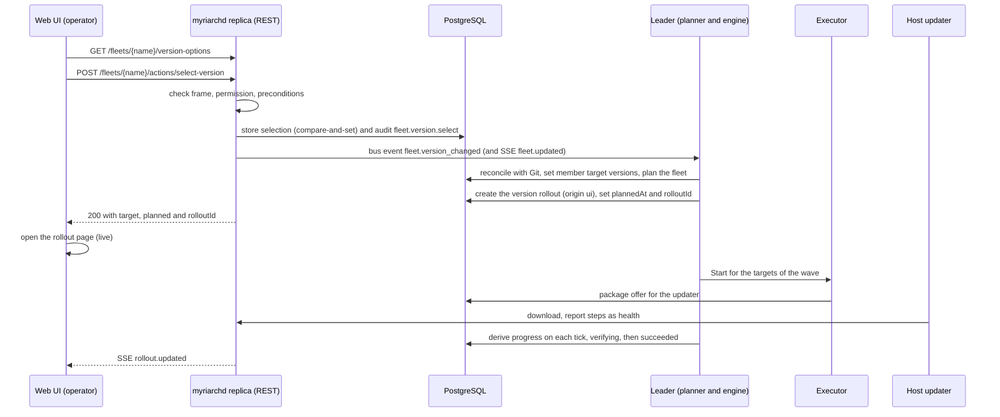

This document is the normative contract for choosing the target collector version of a fleet from the web UI or the
REST API while Git stays in charge. It covers four parts that depend on each other:

- the frame that Git declares (`spec.update.selection`),
- the effective target and the rules that resolve conflicts between Git and a UI choice,
- the REST operations, live events, permission and audit trail,
- the shape of the live progress that a version rollout reports per target.

The host-side half of a version update (what the updater reports and how it installs a package) is described in
[updater-protocol.md](updater-protocol.md). The rollout planner and engine that consume the effective target are
described in [opamp-server.md](opamp-server.md#rollout-planner-and-engine).

## Principles

1. Git sets the frame. It decides whether the UI may choose a version at all, which versions are selectable and which
   rollout policy applies.
2. The UI chooses inside that frame. Every choice is audited and visible as "set in the UI" with who, when and why.
3. The most recent explicit intent wins, and nothing downgrades a collector by surprise. When Git changes after a
   choice was made, a fixed set of rules (see [Conflict rules](#conflict-rules)) decides what happens.
4. Rollouts are created only by the planner on the leader replica. The API stores the choice and asks the leader to
   plan. This keeps a single writer for rollouts when several replicas run.
5. The end of a version update is always the version the collector itself reports. No callback from an external system
   marks a target as finished.

## Terms

| Term | Meaning |
|---|---|
| Git target | `spec.collector.version` of a fleet, normalized (no leading `v`). Empty means "not set". |
| UI selection | A version chosen by an operator through the UI or API. At most one per fleet. Stored in the database, not in Git. |
| Frame | The `spec.update.selection` block of the fleet in Git: what may be chosen. |
| Effective target | The version a fleet is rolled out to, resolved from the UI selection and the Git target. |
| Source | Where the effective target comes from: `git`, `ui`, `hold` or `none`. |
| Hold | State of a fleet whose UI selection became invalid because Git removed the version from the frame. The fleet has no target until a person or Git acts. |

A UI selection carries these attributes: `version`, `state` (`active` or `invalidated`), `stateReason`, `gitVersion`
(the Git target at the time of the choice), `gitCommit` (the applied Git revision at that time), `selectedBy` (an
actor reference such as `user:<uuid>` or `token:<uuid>`, shown as a display name by the API), `selectedAt`, `reason`,
`rolloutId`, `plannedAt` and `updatedAt`. In the OpenAPI document this is the schema `FleetVersionSelection`.

Persistence: one row per fleet in the table `fleet_version_selections`, plus the column `rollout_targets.progress`
(jsonb). The history of choices is the audit log, queryable with `GET /audit?targetType=fleet&targetId=<fleet>`.

## The frame in Git

### Format

```yaml
apiVersion: myriarch.dev/v1alpha1
kind: Fleet
metadata: {name: edge-gateway}
spec:
  collector:
    distribution: otelcol-contrib
    version: 0.161.0              # Git target. Optional when selection is enabled: empty means no target until chosen
  update:
    executor: updater             # none | updater | webhook | awx | manual
    selection:
      enabled: true               # default false; a missing block means false
      versionRange: ">=0.161.0, <=0.162.0"   # semver constraint without "v" ... OR:
      # versions: [0.161.0, 0.162.0]         # explicit list (exactly one of the two)
      allowDowngrade: false       # default false: only versions >= the current effective target
      requireReason: false        # default false: a reason is mandatory when choosing or clearing
      rolloutPolicy: ""           # default: spec.rollout.versionPolicy, else "default"
  rollout:
    versionPolicy: gateway-version
```

| Field | Default | Meaning |
|---|---|---|
| `enabled` | `false` | UI and API updates are allowed. Requires an executor other than `none`. |
| `versionRange` | none | A Masterminds semver v3 constraint over versions without `v`. A prerelease does not satisfy a range that has no prerelease part. |
| `versions` | none | Alternative: an explicit list of selectable versions. Exactly one of `versionRange` and `versions` is required when enabled. |
| `allowDowngrade` | `false` | When `false`, only versions at or above the current effective target can be chosen. Without a target, the reference is the highest version among the fleet members. |
| `requireReason` | `false` | A reason is mandatory when choosing and when clearing. |
| `rolloutPolicy` | `rollout.versionPolicy`, else `default` | Rollout policy for rollouts caused by a UI choice. |

OpenAPI: `UpdateSpec.selection` is a `VersionSelectionSpec`.

### Validation rules

The myriarchd sync and `myrctl validate` apply the same checks. The issue code is `selection_invalid` and the severity is
`error` unless noted otherwise. An unknown key inside the block (for example a misspelled `versionrange`) is reported as
`unknown_field` like everywhere else.

| Rule | Message (English, as emitted) |
|---|---|
| `enabled: true` with neither `versionRange` nor `versions`, or with both | `exactly one of update.selection.versionRange or update.selection.versions is required` |
| `versionRange` cannot be parsed as a constraint | `versionRange "<value>" is not a valid semantic version constraint` |
| An entry of `versions` is not a strict semantic version, has a leading `v`, or is empty | `versions[<i>] "<value>" must be a semantic version without "v"` |
| An entry of `versions` appears twice | `versions[<i>] "<value>" is listed twice` |
| `enabled: true` with executor `none` or no executor | `UI-triggered updates need an update executor (update.executor is none)` |
| `collector.version` is set and lies outside the frame | `collector.version <v> is outside update.selection (<frame>)` |
| `rolloutPolicy` names a policy that does not exist | code `policy_not_found` |
| `enabled: false` while `versionRange` or `versions` is set | warning `update.selection is disabled: versionRange/versions are ignored` |
| Executor `manual` or `updater` with an `executorRef` | warning with code `executor_invalid`: the reference is ignored |
| Warning "executor is X but collector.version is empty" | not emitted when `selection.enabled` is `true` |

### Backward compatibility

A fleet without a `selection` block behaves exactly as before (`enabled: false`). An older myriarchd or `myrctl` rejects
the block as an unknown field, so the GitOps repository and the server are upgraded together.

### Executor manual

`manual` is a built-in executor, like `updater`, and has no executor object.

- `Validate` reports no issues. `Start` marks every target as started (external reference `manual`) and makes no call
  to any system. `Cancel` does nothing. There is no network access.
- Version rollouts are enabled for the executors `updater`, `webhook`, `awx` and `manual`.
- Completion works as for every executor: the collector reports the new `service.version`. The `applyTimeout` of the
  rollout policy bounds the wait.
- A rollback wave of a `manual` rollout starts with the previous version, which again means "wait for the reported
  version".

It fits setups where the version is changed outside myriarchd (an image tag bump through a merge request, an operator on
the host) and myriarchd only tracks the result.

## Effective target and conflict rules

### Effective target

The resolver `domain.ResolveVersionTarget(fleet, selection)` is the single place that decides the target.

| Case | `version` | `source` |
|---|---|---|
| UI selection is `active` | the selected version | `ui` |
| UI selection is `invalidated` | empty | `hold` |
| no selection, Git target set | the Git target | `git` |
| no selection, no Git target | empty | `none` |

Version rollouts are created only when the version is non-empty and the executor is not `none`. In OpenAPI the result
is `FleetVersionTarget` (with the enum `VersionTargetSource`), exposed as `FleetStatus.versionTarget`.

### Where the effective target applies

Every consumer uses the resolver. No other code reads `spec.collector.version` as the target of a rollout:

- the rollout planner (relevant targets, current target, whether version rollouts are enabled, rollout creation),
- agent assignment (`TargetVersion` of each collector),
- fleet statistics (target version, collectors on target, "behind latest"),
- the release views (fleets behind, updatable fleets),
- the dashboard summary of outdated collectors,
- artifact prefetch.

### Conflict rules

After each applied GitOps snapshot, before the agents are reassigned, and at the start of every planner run, the leader
evaluates every stored selection against Git. The evaluation is idempotent. For one selection the first matching rule
wins, and the actor of every audit entry is `gitops`.

| Rule | Condition | Effect | Audit action |
|---|---|---|---|
| K4 | The fleet no longer exists in Git | The selection is deleted. | `fleet.version.removed` |
| K1 | The normalized Git target differs from the `gitVersion` stored with the selection (changed, newly set or removed since the choice) | The selection is deleted and the new Git target applies. The most recent intent wins. | `fleet.version.superseded` |
| K2a | The `selection` block is missing or disabled, or the executor is `none` | The selection is deleted and the Git target applies. Git withdrew the UI control. | `fleet.version.superseded` |
| K2b | The selection is `active` but its version is no longer inside the frame | The selection becomes `invalidated` with a reason that names the version, commit and frame. The fleet is in hold: no target. A running version rollout is superseded with the reason "the fleet no longer manages the collector version". Collectors that already updated stay on their version. | `fleet.version.invalidated` |
| K5 | none of the above | Unchanged. | none |

A hold ends in one of three ways: a new valid selection, `clearFleetVersionSelection` (the Git target applies again,
and the UI warns about a possible downgrade), or a change of `spec.collector.version` in Git (rule K1). Widening the
frame later does not reactivate an invalidated selection. `allowDowngrade` and `requireReason` are checked only when a
version is chosen, never during reconciliation.

Consequences to document for operators:

- K1, K2a and clearing a selection can cause a downgrade when the Git target is lower than the running version. The
  updater refuses downgrades other than the one-step return to its previous version (see
  [updater-protocol.md](updater-protocol.md#anti-downgrade-policy)).
- After a rollback of a version rollout the selection stays active. The targets are `failed` or `rolled_back` and are
  not rolled out again (see the exclusion rules in [opamp-server.md](opamp-server.md#rollout-planner-and-engine)).
  The operator retries failed targets or clears the selection.
- While a version rollout of the fleet is `failed` or `rolling_back`, a new selection is refused with 412. The rollout
  has to be aborted first.
- A rollout caused by a UI choice has `origin: ui`, the operator's display name as `createdBy`, the reason as
  `requestReason` and an annotation `selection` (version, who, when, why). Rollouts whose target comes from Git have
  `origin: gitops`; `system` covers everything else. The actor reference is stored in `created_by` (`gitops`,
  `user:<uuid>` or `token:<uuid>`), and the API shows display names. A UI rollout uses the policy named by
  `selection.rolloutPolicy`.

### Flow of a selection



The API handler waits up to 10 seconds for the leader to plan the fleet. When it did, the response has `planned: true`
and the `rolloutId` (absent if no member needs an update). Otherwise the response has `planned: false` and the UI waits
for `fleet.updated` or `rollout.updated`.

## REST, events, permission and audit

The authoritative definition is `api/openapi.yaml`. This section summarizes the behaviour that clients rely on.

### Operations

| operationId | Path | Permission | Behaviour |
|---|---|---|---|
| `getFleetVersionOptions` | `GET /fleets/{name}/version-options` | `read` | Returns `FleetVersionOptions`: `allowed` with `notAllowedCode` (`selection_disabled`, `no_executor`, `blocking_rollout`), `target` (`FleetVersionTarget`), `executor`, `versionPolicy`, `activeRollout` (`RolloutSummary`), `options[]` and `platforms[]`. Options are newest first. Candidates are the known non-prerelease releases that satisfy the frame, the entries of `selection.versions`, the Git target and the version of an existing selection. Each `VersionOption` has `selectable` and, if not selectable, a `reasonCode` (`current_target`, `outside_frame`, `downgrade_not_allowed`, `prerelease_not_allowed`, `unknown_version`). The operation works for every fleet: without a frame, `allowed` is false and only the Git target is listed. |
| `selectFleetVersion` | `POST /fleets/{name}/actions/select-version` | `fleets:set_version` | Body `SelectFleetVersionRequest` (`version`, optional `reason` up to 500 characters, optional `expectedTargetVersion`). Response `SelectFleetVersionResponse` (`target`, `planned`, `rolloutId`, `targets`, `message`). |
| `clearFleetVersionSelection` | `POST /fleets/{name}/actions/clear-version-selection` | `fleets:set_version` | Optional body `ClearFleetVersionSelectionRequest` (`reason`). Response `FleetVersionTarget`. Allowed even when the frame is disabled. |

Other operations carry the result:

- `getFleet` and `listFleets` return `FleetStatus.versionTarget` (required field).
- `getRelease` returns `ReleaseDetail.updatableFleets[]` (`ReleaseFleetOption`: the fleet, its target, whether this
  release is selectable and why not).
- `getRollout`, `listRollouts` and the target listing return `Rollout.origin` (required), `Rollout.createdBy` (display
  name), `Rollout.requestReason`, `RolloutSummary.origin` and `RolloutTarget.progress` (`TargetProgress`).
- `getMe` lists the permission `fleets:set_version` for the roles operator and admin.

### Preconditions and error codes

Errors use `application/problem+json` with a stable `code`. Texts are English. Clients translate by code.

| Status | Condition |
|---|---|
| 400 | Malformed request. |
| 404 | The fleet does not exist. |
| 409 | `expectedTargetVersion` differs from the current effective target (someone else changed it). The empty string means "no target". |
| 412 | The frame is disabled, the executor is `none`, or a version rollout of the fleet is `failed` or `rolling_back`. |
| 422 | `issues[].code` is one of `version_not_allowed`, `downgrade_not_allowed`, `unknown_version`, `prerelease_not_allowed`, `reason_required`. |

Selecting the version that is already the effective target stores nothing and returns 200 with `planned: false` and a
message, but still writes an audit entry with `details.noop = true`. Clearing when no selection exists changes nothing,
returns the current target with status 200 and is audited the same way. When `requireReason` is set, clearing without a
reason is a 422 with the issue code `reason_required`.

### Live events

`GET /events/stream` (operationId `streamEvents`) carries two events relevant here:

- `fleet.updated` with `LiveFleetUpdatedData {name}`: the effective target or the UI selection of a fleet changed
  (select, clear, superseded or invalidated by Git). Clients refetch the fleet views.
- `rollout.updated` with `RolloutSummary`: a rollout changed. Target progress is part of the rollout detail and is
  refetched on this event. The UI also polls every few seconds as a fallback.

### Permission

The permission is `fleets:set_version`, granted to the roles operator and admin. It is separate from the other rollout
permissions so that it can be assigned independently later.

### Audit events

All entries use `targetType: fleet` and `targetId: <fleet>`.

| Action | Actor | Result | Details |
|---|---|---|---|
| `fleet.version.select` | operator or API token | `success`, or `failure` for refused attempts including 409, 412 and 422 (reason in `details.error`) | `version`, `reason`, `previousVersion`, `previousSource`, `gitVersion`, `gitCommit`, `rolloutId` when known, `noop` when nothing changed |
| `fleet.version.clear` | operator or API token | success or failure | `version` of the removed selection, `reason`, `gitVersion`, `noop` |
| `fleet.version.superseded` | `gitops` | success | `version`, `gitVersionBefore`, `gitVersionNow`, `commit`, `reason` |
| `fleet.version.invalidated` | `gitops` | success | `version`, `frame`, `commit`, `reason` |
| `fleet.version.removed` | `gitops` | success | `version`, `commit`, `reason` |
| `rollout.create` (existing) | the operator for `origin: ui`, otherwise `gitops` | success | additionally `origin`, `selectedBy`, `reason` |

## Target progress

Version rollouts expose, for every started target, a live progress object (`RolloutTarget.progress`, schema
`TargetProgress`). It is absent for configuration rollouts and for targets that never started.

### Shape

| Field | Content |
|---|---|
| `phase` | `UpdatePhase`: `offered`, `downloading`, `verifying`, `installing`, `restarting`, `health_check`, `rolling_back`, `health_wait`, `succeeded`, `failed`, `rolled_back`, `cancelled`. |
| `source` | `ProgressSource`: `updater` (steps reported by the host updater), `package_status` (only the OpAMP package status of the updater is known, for example an older or simulated updater), `executor` (webhook, awx or manual executors, which have no host-side steps). |
| `steps[]` | `UpdateStep` entries in a fixed order: `offered`, `downloading`, `verifying`, `installing`, `restarting`, `health_check`, `rolling_back` (only when a rollback happened), `health_wait`. Each has `name`, `status` (`pending`, `running`, `done`, `failed`, `skipped`), `startedAt`, `finishedAt` and a short `detail`. For source `executor` only `offered`, `installing` (an external update, waiting for the version) and `health_wait` appear. |
| `downloadPercent` | From the OpAMP package status, 0 to 100. |
| `error`, `attempt`, `fromVersion`, `toVersion`, `updatedAt` | As in the schema. |

### Derivation

The engine on the leader derives progress on each tick and stores it with the target. A tick runs at most about one
second after an agent message. Rules:

- The target status always has the last word. `verifying` means the collector reports the target version and the
  health wait runs (`health_wait`). `succeeded` marks every step as done. `cancelled` and `failed` resolve the steps; a
  host-side rollback ends in phase `rolled_back` with `health_wait` skipped.
- Input is the target, the OpAMP package status of the linked updater and the update health component that the updater
  reports (see [updater-protocol.md](updater-protocol.md#update-health-component)). An attempt belongs to a target when
  its offered version equals `"v"` plus the target version and it started no earlier than two minutes before the target
  started (tolerance for clock differences). Otherwise the attempt counts as not yet begun and the phase is `offered`.
- The progress is frozen when the target reaches a final status. One exception: when the engine fails a target while
  the updater is still running its health check or rollback, the progress keeps following the host until the attempt
  ends, for at most 15 minutes.
  The host reports the end of a rollback in two steps: first the step `rolling_back` is done while the component still
  says `rolling_back`, a few milliseconds later the attempt ends with `rolled_back`. A tick between the two shows phase
  `failed` (steps `health_check` failed, `rolling_back` done); the next tick shows `rolled_back`. So the phase of a
  failed target converges to `rolled_back` about one tick (one second, at most `rollouts.tickInterval`) after the last
  report of the updater. A reader that needs the final phase waits for it instead of reading at a fixed moment.
- Reads normalize inconsistent stored values: a final target status combined with a non-final phase (for example after
  a mass abort) takes its phase from the status, and steps still running become `skipped` for a cancelled target and
  `failed` otherwise.
